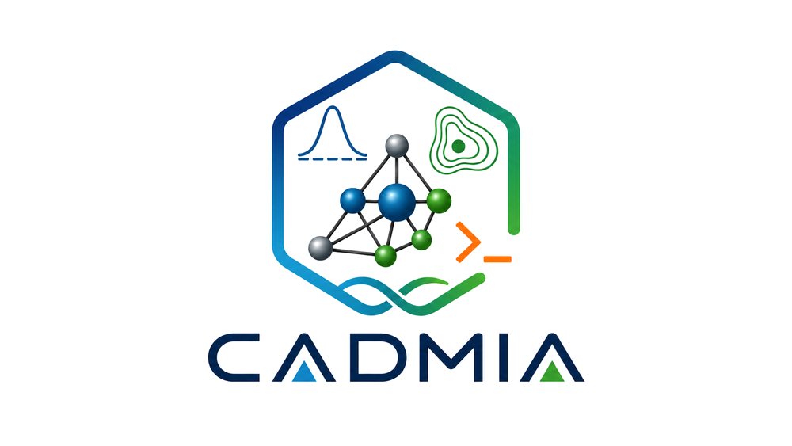

<p align="center">
  
</p>

<h3 align="center">Computational Agent-Driven Molecular Intelligence Architecture</h3>

<p align="center">

[English](README.md) · **Español**

[](https://github.com/Padalher/CADMIA/actions/workflows/ci.yml)
[](LICENSE)
[](pyproject.toml)

</p>

Autor: Pablo Daniel Alvarez Hernandez, Universidad Juárez Autónoma de Tabasco (UJAT)

Estado: alfa. Los comandos y los formatos de salida aún pueden cambiar entre versiones menores.

## ¿Qué es CADMIA?

CADMIA es una suite de línea de comandos para estudiar la reactividad y la adsorción en
nanocúmulos a partir de salidas de química cuántica (ORCA y Gaussian). Lee los cálculos, obtiene
los descriptores, prepara los cálculos siguientes y registra de dónde salió cada número. Un solo
comando, `cadmia`, da acceso a todas las herramientas.

Funciones principales:

- DFT conceptual: descriptores globales (I, A, η, μ, ω) por diferencias finitas o Koopmans, y
  funciones de Fukui condensadas y descriptor dual, coincidentes con Multiwfn.
- Adsorción: configuraciones iniciales de moléculas sonda pequeñas en los sitios más reactivos,
  pre-cribado GFN2-xTB y energética de adsorción (ΔE, ΔH, ΔG, deformación e interacción).
- Estabilidad: energías de mezcla y de enlace frente a los óxidos puros, series de tamaño,
  isómeros y poblaciones de Boltzmann.
- Estructura: números de coordinación (CN, ECN), distancias de enlace, anillos, poliedros de
  coordinación y simetría puntual.
- Estructura electrónica: DOS y PDOS, potencial electrostático sobre la superficie molecular,
  espectros IR y mapas volumétricos (densidad, Fukui, Δρ).
- Cálculos: preparación de entradas, cola local secuencial y envío a SLURM, con flujos
  reanudables.
- Procedencia: resultados guardados en una base de datos SQLite local con el hash del archivo, el
  comando exacto y la versión del programa.
- Ayuda bilingüe (`--help` en inglés, `--ayuda` en español) y reportes en Markdown/LaTeX.

## Novedades de 0.3.0

Solo lo principal; el detalle completo, con las versiones de desarrollo anteriores, está en
[CHANGELOG.md](CHANGELOG.md).

- **Isómeros en `stability-series`:** varios `--cluster` con el mismo n se tratan como isómeros,
  cada uno con grupo puntual, quiralidad, ΔE₀ y ΔG frente a su propio mínimo. Representa a n el
  más bajo en la base elegida (E₀ por defecto); si los mínimos en E₀ y en G no coinciden, se
  conservan ambos y se avisa.
- **Poblaciones de Boltzmann en las dos bases:** `--pop` (apagado por defecto) añade P(G), con σ
  de la geometría y g = 2 para isómeros quirales, y P(E₀), con el mismo g y sin σ. Los
  descriptores promediados por población van rotulados como tales.
- **Energía de mezcla a igual tamaño:** `stability` resuelve los coeficientes como fracciones
  exactas (`--coeff` acepta `1/2` o `0.5`), y `stability-series --ref` empareja óxidos puros de
  cualquier tamaño por estequiometría y reporta ΔE_mix por unidad fórmula.
- **Simetría desde la geometría:** se detectan el grupo puntual, σ y la quiralidad (tolerancia de
  0.01 Å); G y Gq se corrigen cuando el programa usó otro σ.
- **Se comprueba cada término:** `stability` y `stability-series` registran la multiplicidad y
  las frecuencias imaginarias de cada salida, y avisan si faltan frecuencias, si difieren las
  multiplicidades o las temperaturas, si se mezclan entropías de ORCA y Gaussian, o si una salida
  no terminó normalmente.
- **`--energy Gq`:** energía libre con la entropía cuasi-RRHO de Grimme (ν₀ = 100 cm⁻¹, como
  ORCA 6).
- **Corregido:** `electronic mep --density` mide ahora sobre la isosuperficie ρ = isovalor, con
  pesos de área (antes usaba una cáscara que se metía hacia los núcleos); coincide con Multiwfn
  a ≤ 0.52 %. Un cálculo de solo frecuencias de Gaussian ya no se reporta como optimización no
  convergida.

## Requisitos

- Python 3.11 o posterior.
- Salidas de ORCA 6 o de Gaussian 16. ORCA solo hace falta para correr cálculos; el análisis
  funciona en cualquier equipo.
- Opcionales: `xtb` (pre-cribado), SLURM (envío de trabajos) y POV-Ray (render de estructuras).

## Inicio rápido

[](https://colab.research.google.com/github/Padalher/CADMIA/blob/main/examples/quickstart.ipynb)
corre los ejemplos en el navegador, sin instalar nada (cuaderno en inglés).

Desde una copia del repositorio, con las salidas de ejemplo que acompañan a las pruebas:

```bash
cadmia doctor                     # motores, dependencias y configuración
cadmia cdft --n tests/fixtures/1tial_cdft/N.out \
            --np1 tests/fixtures/1tial_cdft/N+1.out \
            --nm1 tests/fixtures/1tial_cdft/N-1.out     # descriptores + sitios reactivos ordenados
cadmia structure report tests/fixtures/1tial_orca/1tial_opt.xyz -o estructura.txt   # coordinación, enlaces, anillos
cadmia guide -es                  # la guía de uso completa
```

## Instalación, documentación y pruebas

La instalación y las pruebas son las mismas que en el [README en inglés](README.md#installation). La guía de uso en
español está en `docs/usage_guide.txt`, y cada comando documenta sus opciones con `--ayuda`.

## Cita y licencia

Si CADMIA se usa en un trabajo publicado, por favor cítalo como indica
[CITATION.cff](CITATION.cff). CADMIA es software libre, distribuido bajo la Licencia Pública General de GNU,
versión 3 o (a tu elección) cualquier versión posterior ([LICENSE](LICENSE)).

## Agradecimientos

CADMIA fue diseñado, dirigido y validado científicamente por Pablo Daniel Álvarez Hernández. Se
emplearon asistentes de código basados en IA para escribir y reestructurar partes del código, las
pruebas automatizadas y la documentación; cada cambio fue revisado y validado por el autor. Los
resultados numéricos provienen siempre de las salidas de química cuántica, nunca de un modelo de
lenguaje.

## Contacto

Errores y preguntas: [GitHub Issues](https://github.com/Padalher/CADMIA/issues).

Contacto directo: Pablo Daniel Alvarez Hernandez — pablo.alvarez@padalher.com — https://padalher.com
