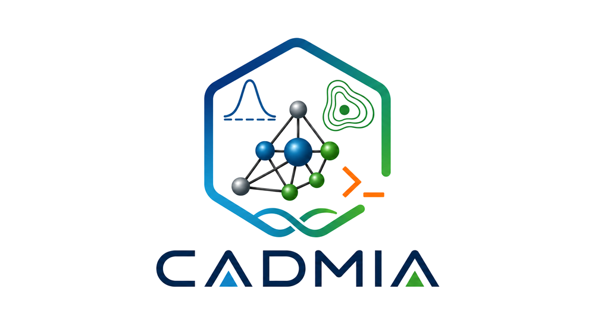

<p align="center">
  
</p>

<h3 align="center">Computational Agent-Driven Molecular Intelligence Architecture</h3>

<p align="center">

**English** · [Español](https://github.com/Padalher/CADMIA/blob/main/README.es.md)

[](https://doi.org/10.5281/zenodo.23608477)
[](https://github.com/Padalher/CADMIA/actions/workflows/ci.yml)
[](https://github.com/Padalher/CADMIA/blob/main/LICENSE)
[](https://github.com/Padalher/CADMIA/blob/main/pyproject.toml)

</p>

Author: Pablo Daniel Álvarez Hernández, División Académica de Ciencias Básicas (DACB), Universidad Juárez Autónoma de Tabasco (UJAT)

Versions follow [Semantic Versioning](https://semver.org): before 1.0.0, a minor version may change
commands or output formats, and every such change is listed in the changelog. 1.0.0 will mark a
stable public interface.

## What is CADMIA?

CADMIA is a command-line suite for studying the reactivity and adsorption properties of
nanoclusters from quantum-chemistry outputs (ORCA and Gaussian). It reads the calculations,
derives the descriptors, prepares the next calculations and records where every number came from.
A single command, `cadmia`, gives access to every tool.

Main features:

- Conceptual DFT: global descriptors (I, A, η, μ, ω) by finite differences or Koopmans, and
  condensed Fukui functions and the dual descriptor, matching Multiwfn.
- Adsorption: starting configurations for small probe molecules on the most reactive sites,
  GFN2-xTB pre-screening, and adsorption energetics (ΔE, ΔH, ΔG, deformation and interaction).
- Stability: mixing and binding energies against the pure oxides, size series, isomers and
  Boltzmann populations.
- Structure: coordination numbers (CN, ECN), bond lengths, rings, coordination polyhedra and
  point-group symmetry.
- Electronic structure: DOS and PDOS, electrostatic potential on the molecular surface, IR spectra
  and volumetric maps (density, Fukui, Δρ). DOS, PDOS, IR and the structural plots come as
  interactive HTML or as PNG, SVG and PDF figures at one- or two-column width (`--width`).
- Calculations: input preparation, a local sequential queue and SLURM submission, with
  resumable pipelines.
- Provenance: results stored in a local SQLite database with file hash, exact command and
  program version.
- Bilingual help (`--help` in English, `--ayuda` in Spanish) and a fixed-width text report of all
  the modules (`reports/cadmia.out`), with a Markdown summary and LaTeX tables on request.

### The name

- **Computational:** it works on the outputs of quantum-chemistry programs.
- **Agent-Driven:** each step is done by an agent, a module with one responsibility that records
  the provenance of what it reads and writes (validation, CDFT, geometry, pre-screening,
  calculation, analysis, stability, report, diagnosis…); the orchestrator (`cadmia pipeline`)
  chains them. The agents are deterministic: the optional language model only writes text and
  never produces a number.
- **Molecular:** clusters and the probe molecules adsorbed on them.
- **Intelligence:** each decision is guided by the data: the Fukui functions choose the sites,
  GFN2-xTB screens the configurations before DFT, and failed calculations are diagnosed.
- **Architecture:** one suite of modules over a common data core.

## What's new in 0.3.2

Highlights only; the full detail is in
[CHANGELOG.md](https://github.com/Padalher/CADMIA/blob/main/CHANGELOG.md).

- **Extended XYZ:** every `.xyz` that `geometry`, `prescreen`, `rank` and `cdft` write carries the
  energy in Hartree, charge, multiplicity and the stage's keys, and is readable by ASE and OVITO;
  `cdft` also writes `results/cdft_sites.xyz` with the per-atom CDFT values as columns.
- **Project database:** `db status` and `db ask` read the project's database inside a project.
- **Clearer CDFT cross-check:** `analyze` no longer counts an ambiphilic binding site as agreeing
  with the CDFT.
- **Supported platform:** Linux.

## What's next

Planned for the next version (subject to change):

- **Extended XYZ:** `cdft`, `prescreen` and `rank` will write `.xyz` files with the energy and its
  unit and per-atom values (charges, Fukui, dual, ECN), readable by viewers such as MOLE
  and by ASE.
- **Plot styles:** other forms for bonds, ECN and DOS plots (bars, sticks, curves).
- **Definitions per module** in the guide; `cadmia.out` will point to them.

## Requirements

- Linux. CADMIA is developed and tested on Linux, where the computing clusters run; macOS and
  Windows are not supported (the commands that analyse existing outputs may work there, without
  guarantee).
- Python 3.11 or newer.
- Outputs from ORCA 6 or Gaussian 16. ORCA is needed only to run calculations; analysis works on
  any machine.
- Optional: `xtb` (pre-screening), SLURM (job submission) and [MOLE](https://github.com/Padalher/MOLE)
  (`pip install mole-viewer`, a quick viewer for sets of structures).

## Installation

```bash
python -m venv ~/cadmia-env
source ~/cadmia-env/bin/activate
pip install cadmia            # core, from PyPI
pip install "cadmia[full]"    # optional: figures and interactive 2D plots
cadmia doctor                 # checks engines, dependencies and configuration
```

From a clone of this repository, `pip install -e ".[full]"` installs the working copy instead.

## Quick start

[](https://colab.research.google.com/github/Padalher/CADMIA/blob/main/examples/quickstart.ipynb)
runs the examples in the browser, with nothing to install.

From a clone of the repository, with the sample outputs that ship with the tests:

```bash
cadmia doctor                     # engines, dependencies and configuration
cadmia cdft --n tests/fixtures/1tial_cdft/N.out \
            --np1 tests/fixtures/1tial_cdft/N+1.out \
            --nm1 tests/fixtures/1tial_cdft/N-1.out     # descriptors + ranked reactive sites
cadmia structure report tests/fixtures/1tial_orca/1tial_opt.xyz -o structure.txt   # coordination, bonds, rings
cadmia guide                      # the full user guide
```

## Documentation

- `cadmia --help` and `cadmia <command> --help` (English); `--ayuda` (Spanish).
- User guide: `docs/usage_guide_en.txt` (English) and `docs/usage_guide.txt` (Spanish).
- Dictionary of terms and descriptors: [docs/descriptor_dictionary.md](https://github.com/Padalher/CADMIA/blob/main/docs/descriptor_dictionary.md).
- Validation of the CDFT descriptors against Multiwfn: [docs/cdft_vs_multiwfn.md](https://github.com/Padalher/CADMIA/blob/main/docs/cdft_vs_multiwfn.md).
- Changes between versions: [CHANGELOG.md](https://github.com/Padalher/CADMIA/blob/main/CHANGELOG.md).

## Tests

```bash
pip install -e ".[dev]"
pytest tests/ -q
```

## Citation and license

If CADMIA is used in published work, please cite it as described in
[CITATION.cff](https://github.com/Padalher/CADMIA/blob/main/CITATION.cff). CADMIA is free software, distributed under the GNU General Public License,
version 3 or (at your option) any later version ([LICENSE](https://github.com/Padalher/CADMIA/blob/main/LICENSE)).

## Acknowledgements

CADMIA was designed, directed and scientifically validated by Pablo Daniel Álvarez Hernández.
AI-based coding assistants were used to write and refactor parts of the code, the automated
tests and the documentation; every change was reviewed and validated by the author. Numerical
results always come from the quantum-chemistry outputs, never from a language model.

## Contact

Bugs and questions: [GitHub Issues](https://github.com/Padalher/CADMIA/issues).

Questions about the software: contact@padalher.com

Direct contact: Pablo Daniel Álvarez Hernández — pablo.alvarez@padalher.com — https://padalher.com
